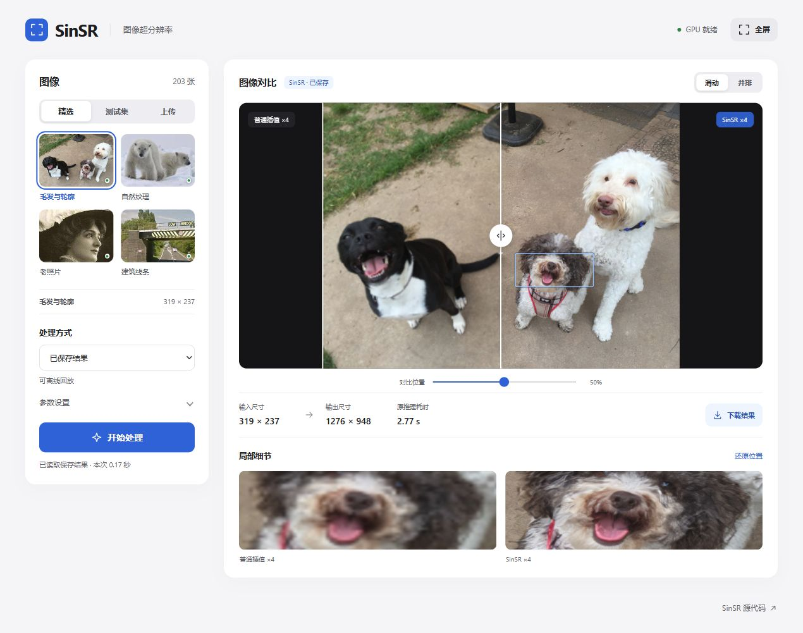

# SinSR_Demo

**面向课堂展示的 SinSR 单步扩散 4× 图像超分辨率 Demo。** 在本地网页中选择测试图或上传图片，运行 GPU 推理，通过滑动对比、并排视图和局部放大观察恢复细节，并下载 PNG 结果。

Demo 提供 iOS 风格中文界面、203 张内置测试图，以及四组可在 CPU 上离线回放的真实 SinSR 结果。

[下载 v1.0.0](https://github.com/gzl1234567890/SinSR_Demo/releases/tag/v1.0.0) · [版本记录](CHANGELOG.md) · [SinSR 论文实现](https://github.com/wyf0912/SinSR)



## 功能

- **开箱即选图**：RealSet65、RealSR、RealSet128 共 203 张测试图，支持分组、文件名搜索和分页浏览。
- **实时演示与离线回放**：GPU 执行真实 SinSR 推理；已保存结果可在 CPU 上快速回放。普通插值提供同尺寸对照。
- **交互式图像对比**：拖动分界线、切换并排视图、点击主图查看同一位置的局部细节。
- **现场展示**：中文控件、全屏模式、键盘快捷键和 PNG 下载，适合课程汇报与方法演示。

## 获取项目

下载 [sinsr_demo_source.zip](https://github.com/gzl1234567890/SinSR_Demo/releases/download/v1.0.0/sinsr_demo_source.zip)，解压后进入包含 `app.py` 和本 README 的目录。也可以克隆仓库：

```bash
git clone https://github.com/gzl1234567890/SinSR_Demo.git
cd SinSR_Demo
```

## 快速启动

使用 **64 位 Python 3.10**。推荐通过 Conda 创建环境：

```powershell
conda create -n sinsr-demo python=3.10 -y
conda activate sinsr-demo
```

### Windows：CPU 回放

```powershell
powershell -ExecutionPolicy Bypass -File .\setup_demo.ps1 -CpuOnly
python app.py
```

打开 **http://localhost:7860**，在“精选”中选择图片，使用“已保存结果”并点击“开始处理”。四组真实结果已随项目附带，回放阶段无需下载模型权重。

### Windows：GPU 实时推理

使用 NVIDIA 显卡和可用的驱动，在已激活的 Python 环境中执行：

```powershell
powershell -ExecutionPolicy Bypass -File .\setup_demo.ps1
python app.py --check
python app.py --prepare
python app.py
```

配置脚本安装 PyTorch 2.7.1、torchvision 0.22.1 的 CUDA 12.8 构建及演示依赖。`--prepare` 从官方地址下载两个模型，预热推理并生成四组精选结果。首次配置需要联网，准备完成后可本地演示。

已有兼容 GPU PyTorch 的环境可使用 `setup_demo.ps1 -SkipTorch`。指定解释器可使用 `-PythonPath "你的环境\python.exe"`。配置成功后，双击 `start_demo.bat` 即可再次启动。

### Linux 或手动配置

在 Python 3.10 环境中执行：

```bash
# NVIDIA GPU
python -m pip install torch==2.7.1 torchvision==0.22.1 --index-url https://download.pytorch.org/whl/cu128
python -m pip install -r requirements.txt
python app.py --check
python app.py --prepare
python app.py
```

CPU 回放使用 `--index-url https://download.pytorch.org/whl/cpu` 安装 PyTorch，随后安装 `requirements.txt` 并运行 `python app.py`。

## 选择图片与保存结果

在左侧“图像”中选择来源：

| 来源 | 使用方式 |
| --- | --- |
| 精选 | 四张常用图片，附带真实 SinSR 回放 |
| 测试集 | 按分组浏览、搜索文件名、翻页并点击缩略图 |
| 上传 | 选择或拖入 JPG、PNG、WebP 图片 |

| 内置测试集 | 图片数量 |
| --- | ---: |
| RealSet65 | 65 |
| RealSR | 100 |
| RealSet128 | 38 |
| 合计 | 203 |

所有测试图保存在 `testdata/`，`catalog.json` 记录相对路径、尺寸和 SHA-256。缩略图按需生成并缓存在内存。

实时演示推荐先选 **RealSet128**：输入为 128×128，输出为 512×512。上传图片推荐长边 256–512 像素，接收上限为长边 1024 像素、20 MB。

运行后，点击“下载结果”导出 PNG。程序自动保存的输入快照、插值对照和 SinSR 输出位于 `demo_outputs/results/`，回放参数与文件校验记录位于 `demo_outputs/cache/`。实时生成的结果也可切换为“已保存结果”再次展示。

## 课堂演示

上台前启动服务，选择小熊或一张 RealSet128 图片，执行一次“实时 SinSR”完成模型预热。保持服务器终端开启。

| 时间 | 操作 |
| --- | --- |
| 0:00–0:30 | 选择狗图并回放，展示宽、高各放大 4 倍的结果 |
| 0:30–1:20 | 拖动分界线，切换并排视图，对照普通插值与 SinSR |
| 1:20–2:00 | 点击毛发、眼睛与轮廓，放大观察局部细节 |
| 2:00–2:40 | 选择小图，运行一次实时推理 |
| 2:40–3:00 | 下载结果，展示生成的 PNG |

快捷键：`1–4` 切换精选、`Enter` 开始处理、`F` 全屏。结束服务时在终端按 `Ctrl+C`。

### 已验证的运行配置

Windows、RTX 5060 Laptop 8GB、PyTorch 2.7.1+cu128；推理采用 FP16、128 像素分块、112 像素步长和随机种子 12345。

| 图片 | 输入尺寸 | GPU 推理耗时 |
| --- | --- | ---: |
| RealSet128 蝴蝶图 | 128×128 | 约 1.2 秒 |
| 狗 | 319×237 | 约 2.8 秒 |
| 小熊 | 197×136 | 约 1.9 秒 |
| 老照片 | 256×256 | 约 4.2 秒 |
| 建筑 | 554×444 | 约 9.5 秒 |

该配置下，蝴蝶图首次加载模型到页面展示约 6.9 秒，已保存结果回放约 0.1–0.2 秒。四张精选的运行记录见 `demo_outputs/preparation_report.json`；GPU 缓存峰值约 2.1 GiB。页面分别显示推理耗时与本次完整展示用时。

## 模型文件

GPU 用户执行 `python app.py --prepare` 自动下载权重。仓库和 Release 源码包提供下载清单，模型保存在本地 `weights/` 中。

| 模型 | 本地位置 | 大小 |
| --- | --- | ---: |
| [SinSR 主模型](https://github.com/wyf0912/SinSR/releases/download/v1.0/SinSR_v1.pth) | `weights/SinSR_v1.pth` | 约 456 MiB |
| [VQ 自动编码器](https://github.com/zsyOAOA/ResShift/releases/download/v2.0/autoencoder_vq_f4.pth) | `weights/autoencoder_vq_f4.pth` | 约 211 MiB |

也可从以上官方链接手动下载，放入对应位置后运行 `--prepare`。`weights/download_manifest.json` 记录模型来源和 SHA-256。

## 项目结构

```text
SinSR_Demo/
├─ app.py                     # 启动、检查、模型准备入口
├─ demo_backend.py            # 图库、任务、推理、回放与下载
├─ upstream_compat.py         # 运行时兼容层
├─ demo_static/               # HTML、CSS、JavaScript
├─ vendor/SinSR/              # 固定版本的论文推理源码
├─ testdata/                  # 203 张输入图及来源清单
├─ weights/                   # 权重下载清单与本地模型
├─ demo_outputs/
│  ├─ results/                # 输入快照、插值对照、SinSR 输出
│  ├─ cache/                  # 回放参数与校验记录
│  └─ preparation_report.json # 精选图片的运行记录
├─ docs/ui-preview.png        # 界面预览
├─ scripts/package_source.py  # 生成 Release 源码包
├─ setup_demo.ps1             # Windows 环境配置
├─ start_demo.bat             # Windows 启动器
├─ requirements.txt
├─ requirements-dev.txt
├─ test_demo_backend.py
├─ test_attention_compat.py
├─ CHANGELOG.md
├─ THIRD_PARTY_NOTICES.md
└─ LICENSE
```

Release ZIP 的顶层目录名为 `sinsr_demo`，目录内部与仓库一致。

## 验证与打包

验证内置论文源码及运行 API、兼容层测试：

```bash
python app.py --verify-upstream
python -m pip install -r requirements-dev.txt
python -B -m unittest test_demo_backend test_attention_compat -v
```

测试覆盖图库筛选、图像处理、真实结果回放校验、输入校验、前端版本更新和注意力兼容层。

生成发布包：

```bash
python scripts/package_source.py
```

输出 `dist/sinsr_demo_source.zip`，包含 Demo 源码、203 张测试图、四组真实结果及文档。模型权重、Python 环境、本机解释器配置、私人上传和调试文件由打包清单排除。

## 常见问题

- **GPU 检查未通过**：运行 `python app.py --check`，确认 NVIDIA 驱动与 CUDA 版 PyTorch 可用；CPU 环境可选择已保存结果或普通插值。
- **模型下载中断**：从“模型文件”中的官方链接下载，放入 `weights/` 后重新运行 `--prepare`。
- **端口被占用**：运行 `python app.py --port 7861`。
- **双击使用了其他 Python**：在目标环境重新执行配置脚本，或设置 `SINSR_PYTHON` 为解释器路径。
- **更新后页面显示旧样式**：先在终端按 `Ctrl+C` 关闭旧服务，再启动并刷新页面；已有标签页可按 `Ctrl+F5`。界面资源使用内容版本地址。
- **恢复已保存结果**：同时保留 `demo_outputs/results/` 与 `cache/`，或在 GPU 环境运行 `--prepare` 重新生成。

## 来源与许可证

超分辨率算法基于 Yufei Wang 等人的 [SinSR: Diffusion-Based Image Super-Resolution in a Single Step](https://github.com/wyf0912/SinSR)（CVPR 2024）。Demo 提供交互界面、图库、任务管理、回放和运行配置。

`vendor/SinSR` 固定于上游版本 `f1735490e980162435391162ddd18c0642327c5b`，逐文件来源与 SHA-256 保存在 `ORIGIN.json`；兼容适配在 Demo 的 Python 进程内完成。第三方署名和素材来源见 [THIRD_PARTY_NOTICES.md](THIRD_PARTY_NOTICES.md)。

项目保留上游 [CC BY-NC-SA 4.0 学术使用许可](LICENSE)。
